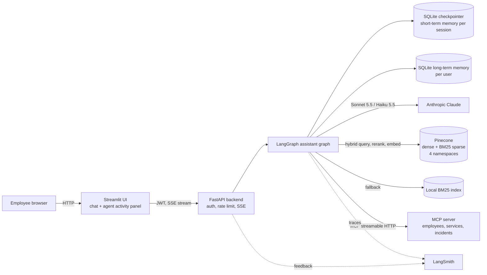
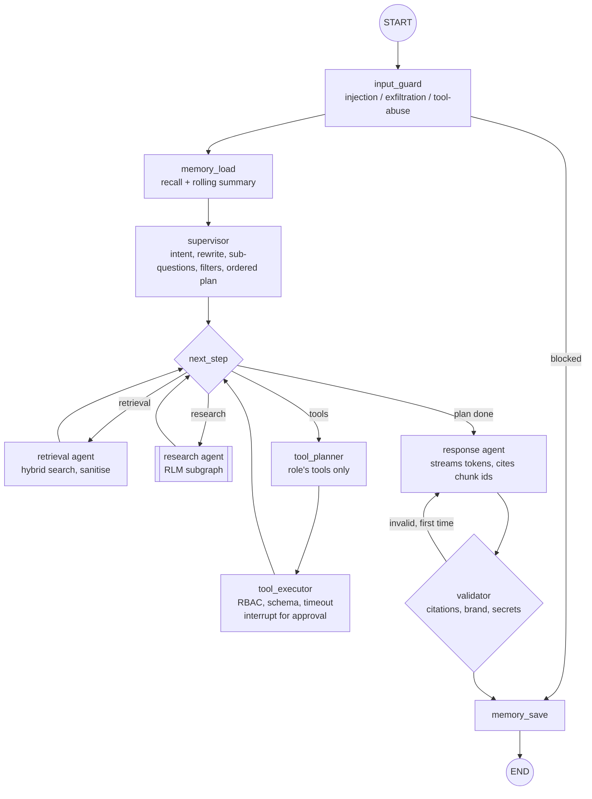
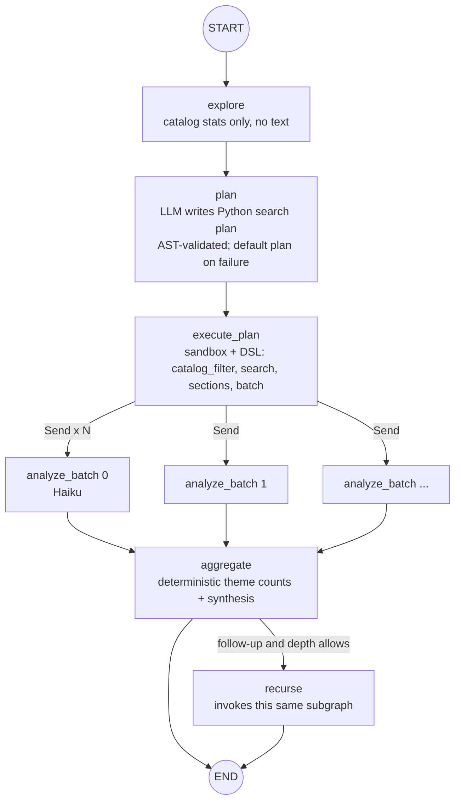

# Architecture

## System

## Assistant graph

The supervisor's plan is data in the state (`plan`, `step_index`), so the control flow is visible
in the trace and the UI, and each worker returns to the router when it finishes.

## Research agent (RLM subgraph)

## Request lifecycle (one turn)

1. Streamlit posts `{message, session_id}` to `/chat/stream` with the JWT.
2. FastAPI verifies the token, loads the user's role from the server-side record and takes a token
   from the user's rate-limit bucket.
3. The graph runs with `thread_id = "<username>:<session_id>"`; turn-scoped state is reset, and
   conversation state is loaded from the checkpointer.
4. Each node emits activity events through LangGraph's custom stream; FastAPI forwards them as SSE.
5. If a state-changing tool is planned, the graph `interrupt()`s; the UI shows Approve / Reject and
   `/chat/resume` continues the same thread with `Command(resume=...)`.
6. The validated answer is stored in conversation and long-term memory; LangSmith holds the trace.

## Retrieval

- **Chunking**: section-aware (markdown headings), 140-word windows with 30-word overlap; the
  title and section are prepended so every chunk describes itself.
- **Index**: one Pinecone serverless index (`dotproduct`), dense vectors from Pinecone-hosted
  `llama-text-embed-v2` (1024-d) plus BM25 sparse vectors, partitioned into namespaces
  `policies`, `engineering`, `operations` and `product`.
- **Query**: role access levels and supervisor filters become a metadata filter; namespaces are
  queried concurrently; `hybrid = 0.6 * dense + 0.4 * sparse`; the top 20 candidates are reranked
  with `bge-reranker-v2-m3`. Every score is kept for the UI and the trace.
- **Attribution**: chunk ids (`DOC-ID#NN`) are the citation format; the validator checks each cited
  id was in the evidence the user was allowed to see.

## Failure handling

| Failure | Detection | Behaviour |
|---|---|---|
| LLM down / error | gateway exception, circuit breaker `llm` | supervisor: keyword routing; research: default plan + heuristic analysis; response: extractive answer with citations; marked degraded |
| Pinecone down / slow | timeout 15 s, breaker `vector_db` | local BM25 with the same access filter; per-namespace failures skipped |
| Rerank fails | exception | fused hybrid order kept |
| MCP down | timeout 10 s, breaker `mcp` | tool result `status=error`; answer says the live data was unavailable |
| Tool timeout | `asyncio.wait_for` | same as above |
| Bad tool arguments | pydantic | `status=rejected`, never executed |
| One research batch fails | exception in that branch | other batches continue; error listed |
| Invalid request | pydantic / guardrails | 4xx with a safe message, or a blocked-request reply |
